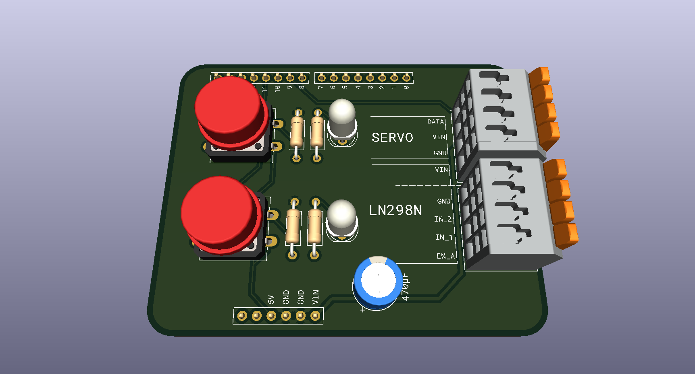
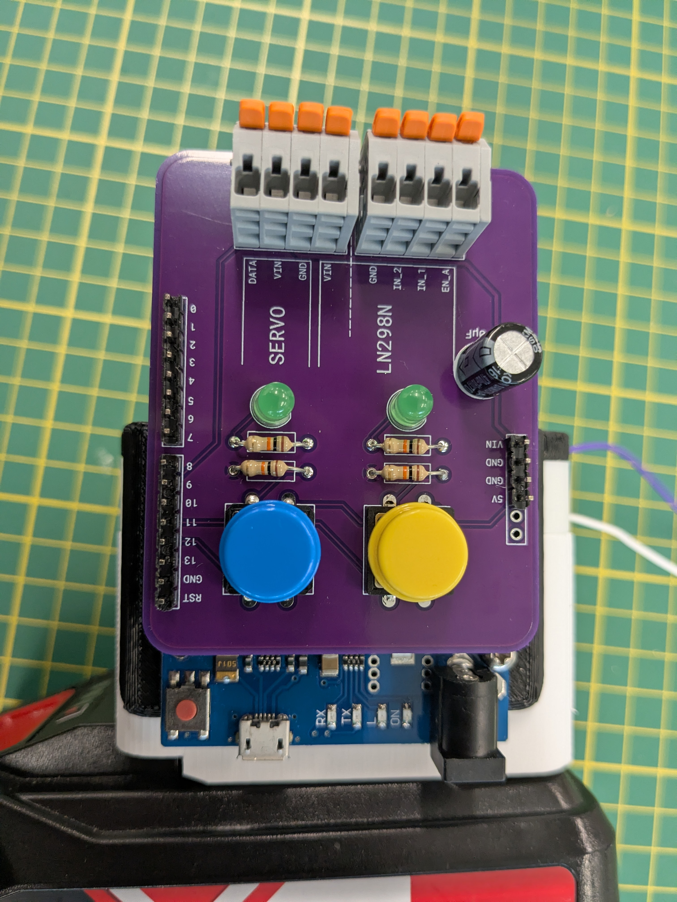
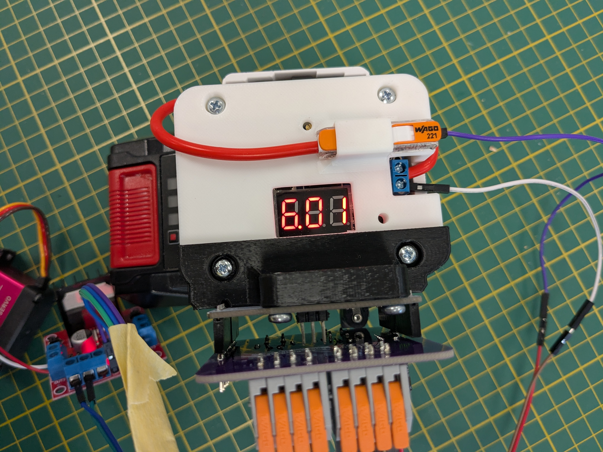
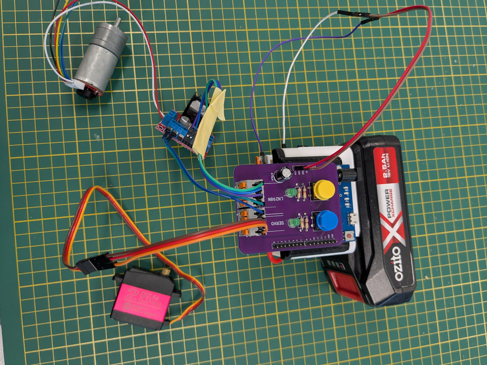

### Tester Project for 2502ENG Mech Eng

Used to test motors (through an L298N) and servos (direct).

Motors will run and servos will rotate when the respective button is pressed. 360deg servos will constantly rotate, but will change direction when the button is pressed. 

Ensure the battery is set around 6-8V to not blow out the servos.

I have also included a mounting bracket that sits on top of the existing battery pack.

# PCB

# BOM

I just used whatever was on hand, nothing is critical

- WAGO 2601-3104 x2
- LED x2 (I have used green LEDs, but red or clear might be easier to see)
- 12mm pushbutton switch x2
- 10k Resistor x4
- 470uF electrolytic capacitor x1 (Anything around 500uF should be fine)
- Long male header pins

# Assembly

1. Solder components. Header pins need enough depth to mount to the Leonardo, but also enough height to attach leads.

2. Attach to Leonardo. 

3. Set voltage

4. Attach servo and L298N board

